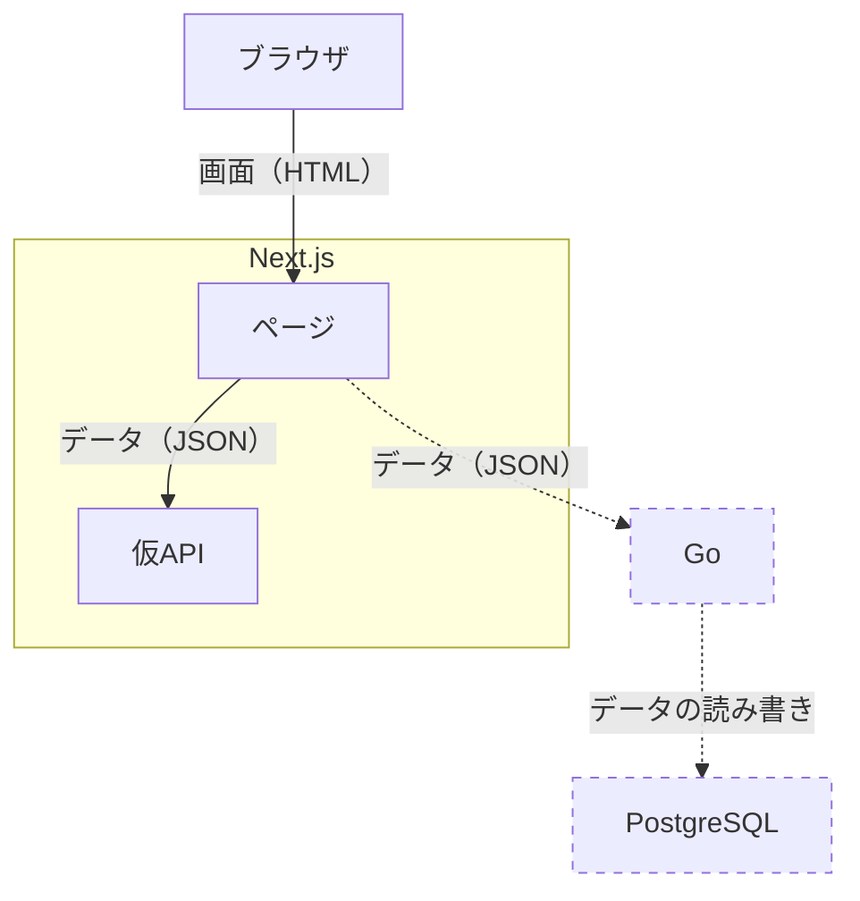
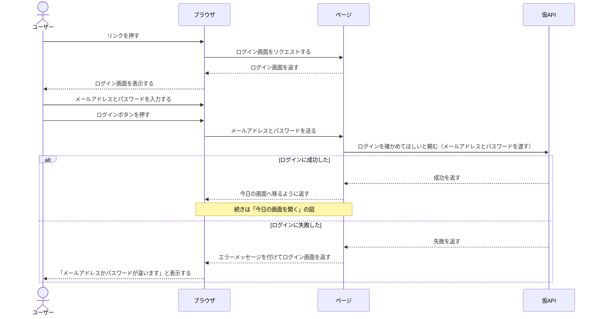
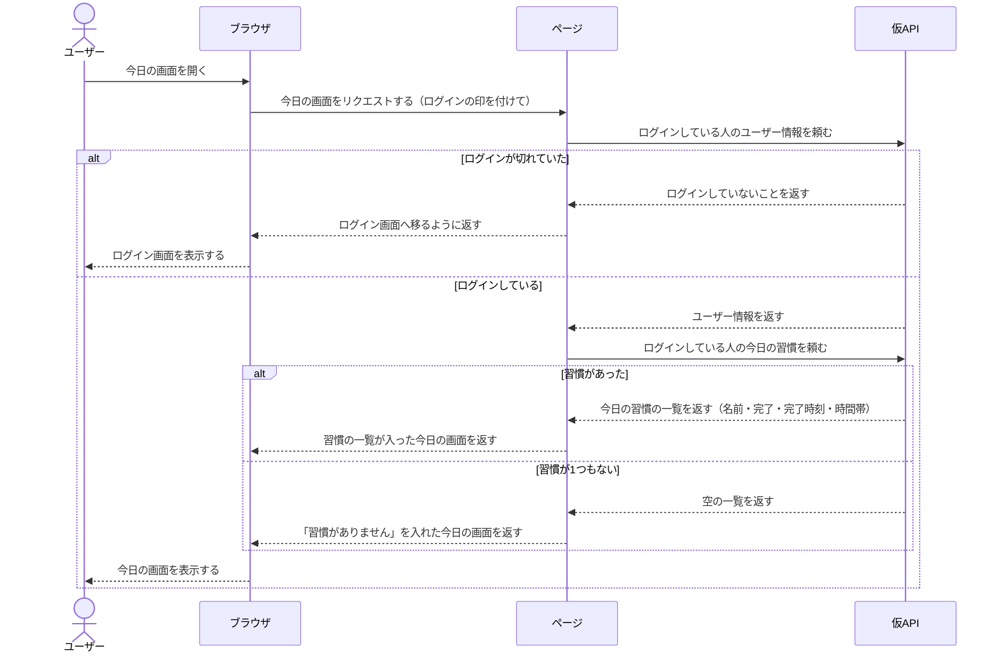
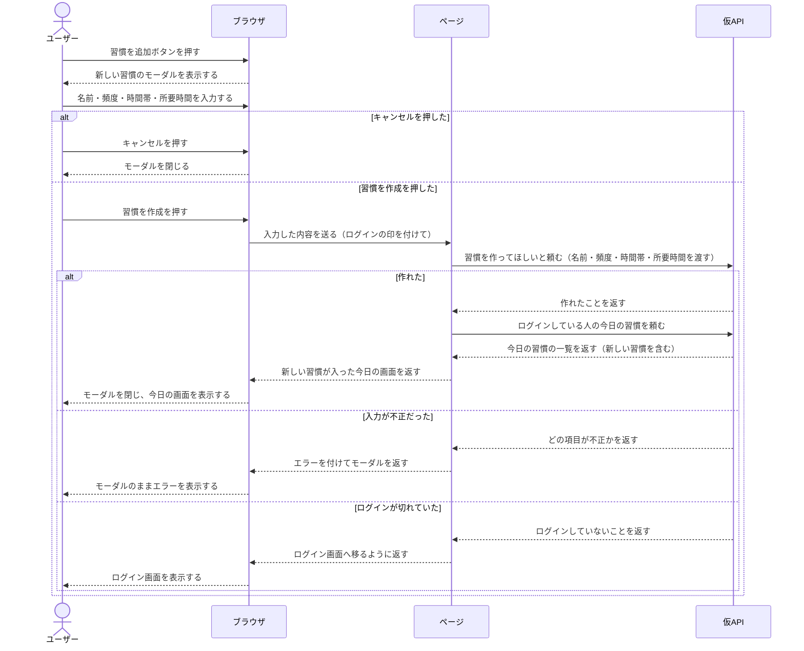
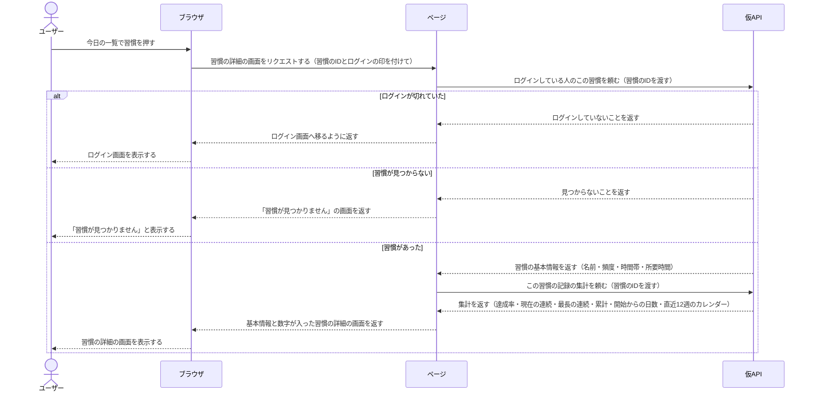

# アーキテクチャ

## 目的

このプロジェクトのアーキテクチャの全体を示す。

## ブロック図

状態：合意済み

点線はフェーズ2以降に作るもの

## シーケンス図

### 目的

誰が誰に、何を、どの順で、頼むのかを示す

### 目標

実装する前に気づくことができる

状態：合意済み

### 「ログイン」 シーケンス図

- 前提：ログインしていない
- 終わりの状態：
  - 成功: ログインが完了している（続きは「今日の画面を開く」の図）
  - 失敗: エラーでログイン画面のまま

### 「今日の画面を開く」 シーケンス図

- 前提：ログイン済み
- 終わりの状態：今日の習慣の一覧が表示されている。ログインが切れていたらログイン画面、習慣がなければ「習慣がありません」の画面で終わります
- フェーズ1で扱わない部品：今日のスケッチ、連続記録、1年後の自分、今日の一言・気分、今週の達成率

- 空の一覧を返すことにした理由
  毎回nullチェックするのはめんどくさい。nullチェックを忘れることはあるので。
- 同時ではなく、順番に頼むことにした理由
  ログインが切れていたらわざわざ習慣を呼ぶ必要がないから順番にした。
- 「今日」を誰が決めるかは、まだ決めていないこと
  今は「未決。API 契約で決める」

### 「習慣を作る」 シーケンス図

- 前提：ログイン済み、今日の画面が表示されている（「今日の画面を開く」の図の終わり）
- 終わりの状態：
  - 作成した: モーダルが閉じ、新しい習慣が今日の一覧に出ている
  - キャンセルした: モーダルが閉じ、今日の画面のまま
  - 入力が不正だった: モーダルのままエラーが表示されている
  - ログインが切れていた: ログイン画面
- 入力する項目：
  - 習慣の名前
  - 頻度（デフォルトは毎日）
  - 時間帯
  - 所要時間
- フェーズ1で扱わない部品：「1年後の自分」に紐づける

- モーダルを開くときに仮APIへ頼まない理由
  開いたばかりのモーダルは空のフォームで、仮APIから取ってくるものがないから。
- 作ったあとに今日の習慣の一覧をもう一度頼む理由
  「今日の画面を開く」と同じ頼み方を使い回せて、一覧の正しさは仮APIにまかせられるから。
- 「1年後の自分」に紐づけるを扱わない理由
  紐づく先の「1年後の自分」をフェーズ1で作らないから。

### 「習慣の詳細を見る」 シーケンス図

- 前提：ログイン済み、今日の画面が表示されている（「今日の画面を開く」の図の終わり）
- 終わりの状態：
  - 習慣があった: 習慣の詳細の画面に、基本情報と数字が表示されている
  - 習慣が見つからない: 「習慣が見つかりません」の画面
  - ログインが切れていた: ログイン画面
- 表示する項目：
  - 基本情報: 名前、頻度、時間帯、所要時間
  - 数字: 達成率（直近30日）、現在の連続、最長の連続、累計、開始からの日数、継続カレンダー（直近12週）
- フェーズ1で扱わない部品：編集、今日の記録をつける、一時停止する、この習慣を削除、最近の記録、「1年後の自分に紐づけ済み」
- 図で省くもの：サイドバーのユーザー名とプラン（「今日の画面を開く」と同じ頼み方）

- 他の人の習慣も「見つからない」と返す理由
  他の人の習慣のIDを開かれても、その習慣があるかどうかを知られないようにするため。
- 基本情報と集計を分けて、順番に頼む理由
  習慣が見つからなければ集計は要らないから。集計は記録から計算するので、基本情報だけ欲しい場面と分けておける。
- 集計を仮APIが計算する理由
  ページが記録を全部受け取って計算しなくて済み、「今日」をどこで決めるかも1か所にまとまるから。
- 記録が0件でも数字は0を返す理由
  「空の一覧」と同じで、null の確認を忘れて画面が落ちるのを防ぐため。
- 「今日」を誰が決めるか（達成率と連続に効く）
  未決。API 契約で決める。
