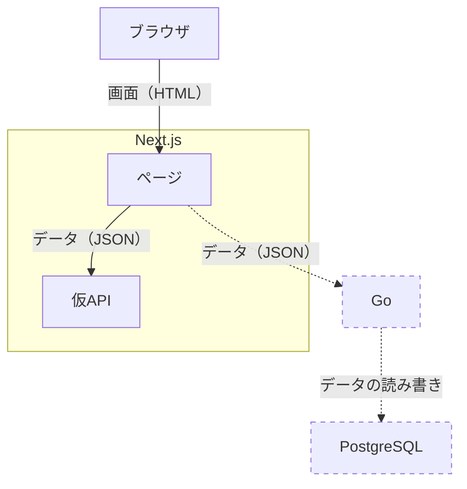
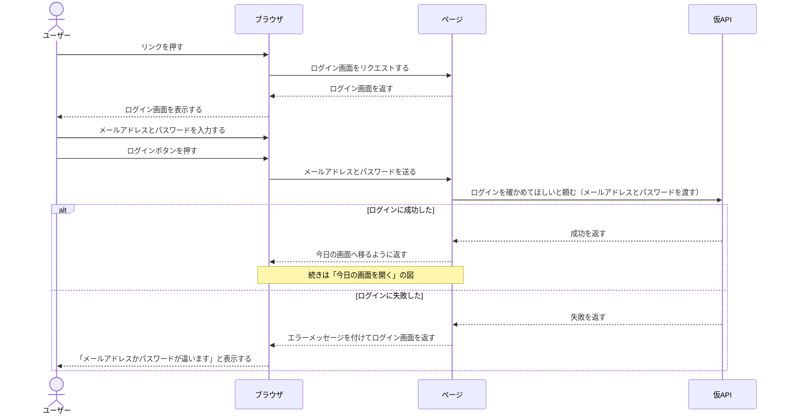
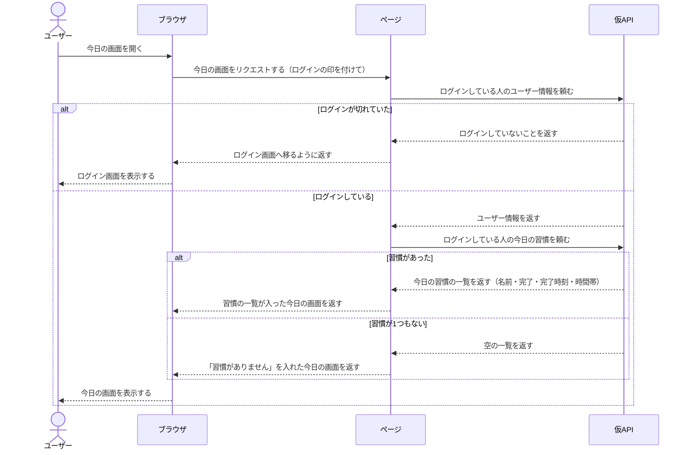

# アーキテクチャ

## 目的

このプロジェクトのアーキテクチャの全体を示す。

## ブロック図

状態：合意済み

点線はフェーズ2以降に作るもの

## シーケンス図

### 目的

誰が誰に、何を、どの順で、頼むのかを示す

### 目標

実装する前に気づくことができる

状態：下書き

### 「ログイン」 シーケンス図

- 前提：ログインしていない
- 終わりの状態：
  - 成功: ログインが完了している（続きは「今日の画面を開く」の図）
  - 失敗: エラーでログイン画面のまま

### 「今日の画面を開く」 シーケンス図

- 前提：ログイン済み
- 終わりの状態：今日の習慣の一覧が表示されている。ログインが切れていたらログイン画面、習慣がなければ「習慣がありません」の画面で終わります
- フェーズ1で扱わない部品：今日のスケッチ、連続記録、1年後の自分、今日の一言・気分、今週の達成率

- 空の一覧を返すことにした理由
  毎回nullチェックするのはめんどくさい。nullチェックを忘れることはあるので。
- 同時ではなく、順番に頼むことにした理由
  ログインが切れていたらわざわざ習慣を呼ぶ必要がないから順番にした。
- 「今日」を誰が決めるかは、まだ決めていないこと
  今は「未決。API 契約で決める」
